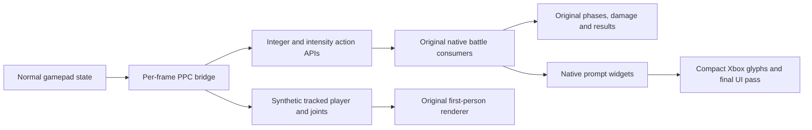

# Conversion architecture

The conversion patches the European game's guest memory at Xenia startup. It does not add Kinect emulation to Xenia and does not statically recompile the entire title. Original state machines, damage, Ki consumption, QTE increments, results, rendering, and save logic remain responsible for gameplay.

## Presence and menus

Hook `82195550` runs after the game's Kinect logic; a camera-poll hook was not called regularly without a camera. The bridge replays `lwz r11,8(r31)` and supplies coherent tracking/presence data. The NUI manager is `*(826491D8)`, with Kinect context at `+1C`. Tracking ID `+2430` is distinct from a controller index. Presence fields include `+2788/+278C`, `+2790`, positional errors `+27A4`, and absence counter `+27AC`.

The selector at `8211A720` consumes pad edges for up/down, A and B, including back-only widgets with no selectable entries. A separate hand-coordinate getter at `821DC5B0` places the old cursor hands outside the canvas. The storage adapter chooses Xenia's simulated HDD for a signed-in profile while preserving the original notification handle. A profile alone had not solved the field-of-view error.

## Native action APIs

`82197118` returns discrete action bits; `82197250` supplies action intensity/progress. A 67-entry table stores a pad mask and held/pressed/window source. Context adapters prevent one action ID from stealing a different action in another phase: X is contextual, Y is charge/release nearby and heavy Ki at distance, B guards, and lateral movement remains distinct.

The final integer entry redirects through `825EFE00`. Only four exact LR values identify the lateral queries before B in the two launch-choice consumers. While B is held, those queries return zero, so the original next query chooses guard. All other callers take the original bridge entry. The helper does not write native phase/result fields or alter the left-stick deadzone.

## Skeleton and first-person arms

Twenty joint vectors are kept coherent in the tracked skeleton and derived buffers `context+B80` and `context+1600`. The native getter `821B7090` reads the latter for the tracked player. Filling only B80 left hand geometry non-finite and affected player projectile generation.

The final arms use authored generic joint trajectories, with the original per-character meshes, native hand-pose clip, and renderer. The accepted native states are 10, 13, 29 and 32; idle-ready states are 0, 1 and 20. Y release is armed only by a valid charge on the same actor in close combat. It keeps preparation valid for five visual lead-in frames, then sends one punch. Interruptions, actor changes, and leaving the context cancel it. This is not an extracted CPU attack animation.

## Super Attacks

A right-stick edge with sufficient Ki arms initiation separately from follow-up gesture windows. The lower threshold is 50 Ki and the upper is 100. Rejected requests are not queued. In native mode 10, continuation gestures can survive long cinematic sequences; scripted continuation can be supplied without spending a second initiation request.

The two-gesture recognizer at `82194E30/82194FD8` has earliest-valid frames at processor `+3C/+40`. Constant synthetic poses had registered too early. `825EFD00` gates the synthetic window until those native lower bounds and lets the original recognizer compute its result. [Super-defense notes](super-defense-v19.md) document opponent-specific UI selectors separately from the player's own Super artwork.

## UI and assets

Thirteen authored glyphs use native 128×128 BC3 allocations (16 KiB each). Their packed data is already LZ4-compressed; the glyph content is centered at 55% of the earlier HD footprint. Native pad texture slots are reused in memory, without editing the game's archives.

Multiple getters and both extra-pose catalogs required separate coverage. Wrappers apply the final pass after native code that would otherwise re-enable pose groups. Pose groups are hidden only for mapped pad textures; the native prohibition node is drawn after the dummy-button node. Original art fallback and player Super poses are preserved. The action-history HUD had a separate UV mirror path that also needed correction.

## Boss, cards, saves

Great Ape QTEs sometimes read recognizer states directly instead of either public action API. The boss-only bridge ORs active aliases rather than letting an inactive alias erase an active one. Type-6/7 pose/camera requests accept RT through the native accumulation path.

The Card Reader replacement supplies native decoded QR fields and invokes the original classifier/save flow. Automatic availability uses the original initializer, not fabricated scores. The final version preserves the active/inactive power-up choice. See [content unlocks](content-unlock.md) for the 150,000-byte save format and its limits.
