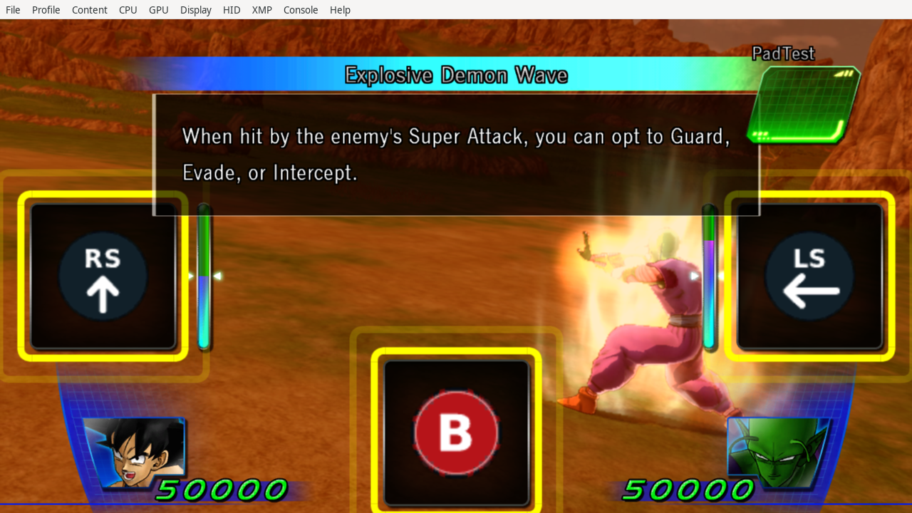

# Revisions 18–19: opponent Super prompts and native gesture timing

Historical [revision19 patch](../experiments/gamepad-feedback-v19/4E4D084E.gamepad-feedback.patch.toml) and [runtime report](../experiments/gamepad-feedback-v19/runtime-checks.json). The final release preserves these rendering/timing/card payloads.

Opponent Super defense uses its own widget texture loader, so replacing ordinary action/common getters missed those icons. Widget kind0 is counter,1 evade,2 guard. There are eleven native selector variants: one guard, four evade types and six counter combinations. Guard shows B; all four evades read held LS-left; counter type1/variant0 reads RS-down, while type1 variants1/2 and types2/3/4 read RS-up. Texture slots16/17 are the game's actual right-stick up/down slots, verified from SPR names, not repurposed unrelated symbols.

Wrappers at825EF800/825EFC00 call original setup and apply the shared bounded UI pass afterward, including the initial visibility routine that could otherwise flash old poses for one frame. Original groups are hidden, the pad dummy shown/unmirrored, and the native prohibition retained above it. The player's own Super pose loader822DF858 and its action-art map remain unchanged. Thirteen compact resources use the original allocations.

Two native guard consumers needed scoped B recognizer2C: normal call822533B8 and scripted/tutorial8225C098. The generic C action is a lateral input in other cinematic contexts, so it was not globally remapped. All four evades use native consumer82253A80; six counter variants use82253B68 and actions30/34/38/39/3C/3F.

A separate Super problem came from constantly asserted follow-up gestures: the native two-gesture recognizer rejected them as too early. In mode10, helper825EFD00 waits for native earliest-valid processor+3C/+40; it does not write the recognizer's result, quality, HP, Ki or battle phase. The six-technique CPU fixture had lower bounds10/20 and expiries30/40: the old result was early1/frame1, while the corrected native result was3/frame21 with both qualities3.

The complete native tutorial was driven from the start without a lesson shortcut. Native guard B, evade LS-left and counter RS-up produced results7/6/5, then the counter gauge reached lessons132/133. The tutorial's long explanation could expire a 300-frame window, so the driver can supply another genuine continuation impulse when requested; that is not a forced native result.

A separate slow Vulkan run used a **local rendering fixture** selecting existing course5/group5 on initial entry only. It showed B, LS-left and RS-up simultaneously during Piccolo's Explosive Demon Wave. The fixture writes only the initial lesson selector and was separately CPU-confined; it is not a full-course completion claim and is excluded from the release. Native readback confirmed hidden pose groups, button textures, seal order, thirteen exact128×128 resources and52 finite geometry regions.

All eleven selector variants were CPU-tested, including missing resources and invalid selectors. Not all character/technique variants were rendered individually. Revision19 also fixed persistent native power-up removal; see [cards](powerup-cards.md).
