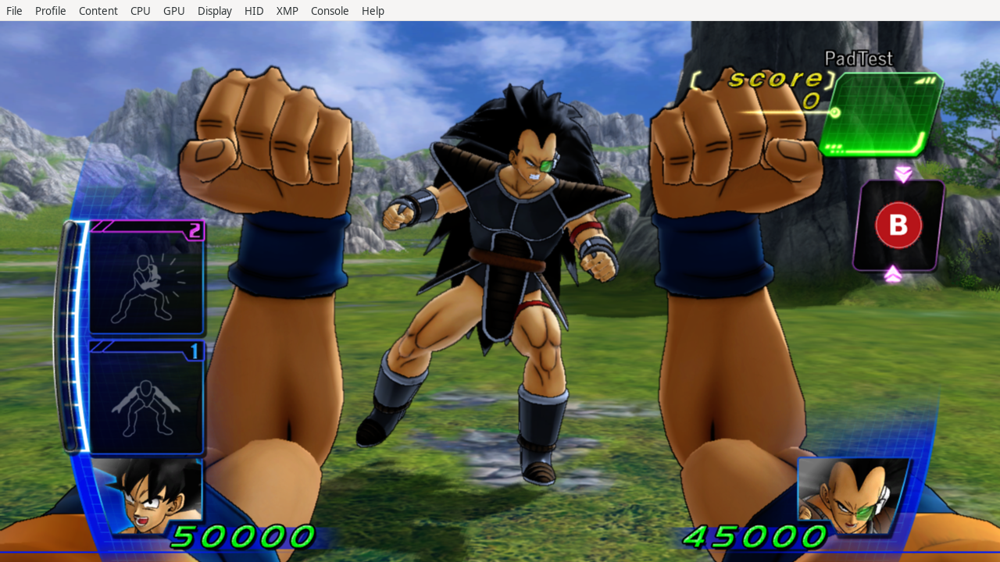
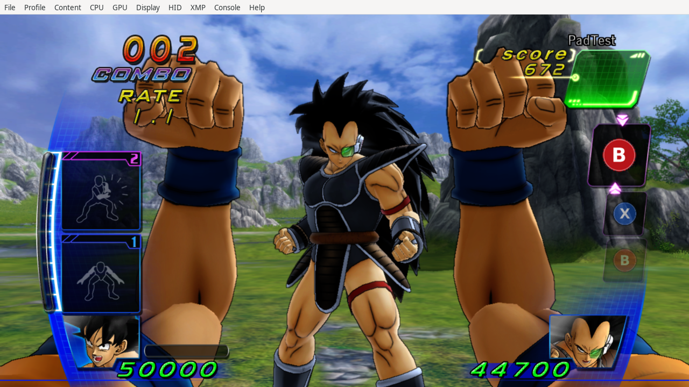

# Version 1.1.1: tucked guard and actual 256 px face buttons

The prominent AI disclaimer in the [README](../README.md) applies. This update
preserves both frozen 1.1.0 artifacts and produces separate European and USA
patches. It changes the B skeleton and face-button resources; the normal X
code, side-selection helpers and motion tables remain byte-identical.

## Guard finding and change

The user reported extended arms when holding B from rest in Europe. The initial
PPC comparison found that 1.0.0 and 1.1.0 selected identical guard coordinates.
A European Goku-versus-Raditz Vulkan run also showed raised fists in 1.1.0.
The precise reported rendering defect was therefore **not reproduced or given
a proven cause**. It would be misleading to call the new pose a diagnosed
regression repair.

The new full guard explicitly tucks both elbows down beside the torso and
raises symmetric fists closer to the face. The six elbow/wrist/hand vectors
at `825EE800` change; the shoulders, root, legs, guard input and native state
machine do not. B still selects the full guard before cosmetic X/Y trajectories
and clears their visual clock. No guard success, HP, timing or state is forced.

The added guard fixture executes the emitted PPC selection/copy chain for
160 held frames per region: idle, both accepted X sides and Y preparation,
near and far. It verifies tightly bent elbows, raised symmetric hands, all
three joint buffers, release, and independent rightward step input. The old
1.1.0 guard deliberately fails the tighter-geometry assertion; this is evidence
that the fixture detects the pose change, not reproduction of the visual report.
[Negative baseline result](../research/update111-regressions.json).

Native pad-only runs observed action `12`, guard flag `2`, state `77`, matching
finite joint buffers, from idle and after two X input histories in both regions.
The European run uses Vulkan; the USA run uses Null GPU. The after-X driver
records input history and does not itself certify an accepted attack; the
separate alternating-arm suite executes the actual native setters.





## Why the icons now have more detail

The user still saw pixelated edges after 1.1.0's supersampling and filtering.
Those changes retained a 128×128 source. The four new face textures are
**256×256 BC3**, or 65,536 decoded bytes each. Their drawing still occupies
55% of the canvas; screen size and transparent spacing stay compact. The
sources use 4× raster supersampling, premultiplied-alpha reduction and RGB
bleeding under transparent edges. Nine other textures retain exactly their
previous decoded bytes and 128×128 dimensions. Fetch word `01280D10` keeps
linear min/mag and the existing RGBA swizzle for the faces.

Writing 65,536 bytes into the old 16 KiB slots would overflow. The adapter at
`825EC580` instead calls the native allocator `823791D8` with the existing
physical texture pool `*(826494A0)`, size 65,536, alignment 4,096 and direction
1, matching the native texture creation path at `82358C48`. It validates the
original slot before allocating, uses the returned handle's `+10` data pointer,
and decodes with the existing bounded LZ4 routine. Only a complete decode
commits the new data pointer, size, 256×256 dimensions and texture fetch words.

Metadata flags change from `A2` to `AA`, setting ownership bit 8. The native
destructor `82358A98` tests that bit, gets the allocation header through
`data-4`, selects its original pool, frees the buffer and clears the pointer.
The emitted failure path calls native free `823794B8` on an uncommitted handle.
Four successful face replacements therefore add 256 KiB of pixel storage,
plus native alignment/header overhead. Repeated UI updates do not allocate
again because the original-size validation rejects already replaced slots.

Twelve decoder cases cover original metadata bounds, owner, dimensions, fetch
format/address, missing resources, allocation failure and a truncated stream.
The test stubs only the external allocator/free API and checks its arguments,
volatile-register clobbers, write bounds, exact decoded bytes and cleanup.
The separate ownership fixture executes the original regional destructor's
ownership branch and back-pointer lookup, recording its external free call.
It verifies an external original buffer is retained and an owned buffer is
freed once, with no repeated free.

The compressed mixed-resolution source is 27,424 bytes, split at independent
LZ4 texture boundaries across checked empty padding:

| Region | Available bytes | Purpose |
| --- | ---: | --- |
| `826BB800..826C0000` | 18,432 | Four face sources |
| `8210EEA8..82110000` | 4,440 | Four other sources, after the QR table |
| `8266EC20..82670000` | 5,088 | Five other sources, after private input state and before `.idata` |

The unused bytes inside `.reloc`'s advertised end were **not** assumed empty:
an original-image scan found nonzero data there. Every selected range is
checked against the original image and other payloads. Source bytes are never
written at runtime. `region_port.py` treats the new source arrays as data;
the additional native allocator/free branches use unique regional anchors.

## Evidence and limits

Both artifacts pass fifteen existing CPU suites plus alternating-arm, guard
pose and native ownership suites: **eighteen per region**. Every immutable
public startup byte was read back without LOCAL hooks. All thirteen loaded
textures match their DDS sources exactly, including the four 256×256 physical
allocations and their native pool/header ownership. European Vulkan captures
show the raised guard and smoother B/X glyphs. A/B/Y share the same verified
generation/loading path; every possible prompt placement was not photographed.

The combat runs use a LOCAL selector-pointer logger for genuine menu navigation.
The exporter verifies that it differs from the exact public patch only at that
hook and its reserved logger; it does not force a battle, animation or outcome.
No live memory writes are available in the supervisor.

The new code has no changes to normal X input, committed side selection or
strike/shot trajectories, verified byte-for-byte. The new artifacts rerun their
actual native setters in isolated PPC tests. The close/ranged gameplay findings
in the [1.1.0 report](update-1.1.0.md) remain historical evidence, rather than
being relabeled as fresh 1.1.1 gameplay tests.

This does not establish every-character, every defensive outcome, full-campaign,
Windows/D3D12 or physical-controller coverage. USA guard observations use Null
GPU and do not establish USA graphical appearance. The optional USA save is
unchanged and retains its independent native-load evidence and inactive card.

- [European exact runtime report](../experiments/gamepad-v1.1.1-europe/runtime-checks.json)
- [American exact runtime report](../experiments/gamepad-v1.1.1-usa/runtime-checks.json)
- [European CPU regressions](../experiments/gamepad-v1.1.1-europe/suite-results.json)
- [American CPU regressions](../experiments/gamepad-v1.1.1-usa/suite-results.json)

## Reproduce

Use the existing pinned analysis environment and privately verified images
described in [building](building.md). No disc or executable is distributed.

```sh
python tools/make_hd_button_assets.py --size 128 --face-size 256 --content-scale .55 --include-super-defense --face-supersample 4 --face-alpha-bleed --out assets/controller-hd256
python tools/build_guard_glyph_update.py
python tools/region_port.py --source experiments/gamepad-v1.1.1-europe/4E4D084E.gamepad.patch.toml --output experiments/gamepad-v1.1.1-usa
python tools/check_hd_prompts_cpu.py --patch experiments/gamepad-v1.1.1-europe/4E4D084E.gamepad.patch.toml
python tools/run_ported_cpu_suite.py tools/check_hd_prompts_cpu.py --patch experiments/gamepad-v1.1.1-usa/4E4D084E.gamepad.patch.toml
python tools/check_guard_pose_cpu.py --patch experiments/gamepad-v1.1.1-europe/4E4D084E.gamepad.patch.toml
python tools/check_texture_ownership_cpu.py --patch experiments/gamepad-v1.1.1-europe/4E4D084E.gamepad.patch.toml
python tools/package_update.py --version 1.1.1 --output dist/1.1.1
```

Run the remaining fixtures listed in each `suite-results.json`, plus guard,
ownership and alternating-arm fixtures for each region. Runtime evidence is
exported with `report_guard_glyph_update.py` only after reproducing its owned
sessions and readback checks; recorded observations are not regenerated by
the builder. Packages enforce matching artifact hashes and validation evidence.
