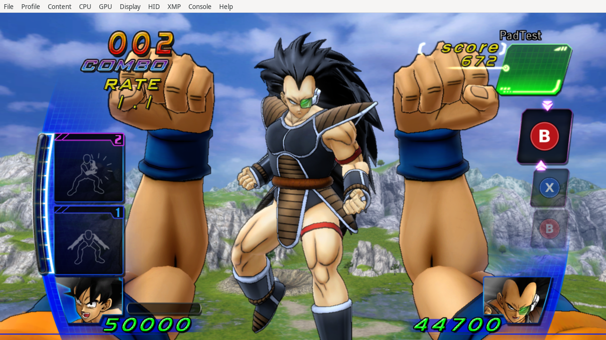
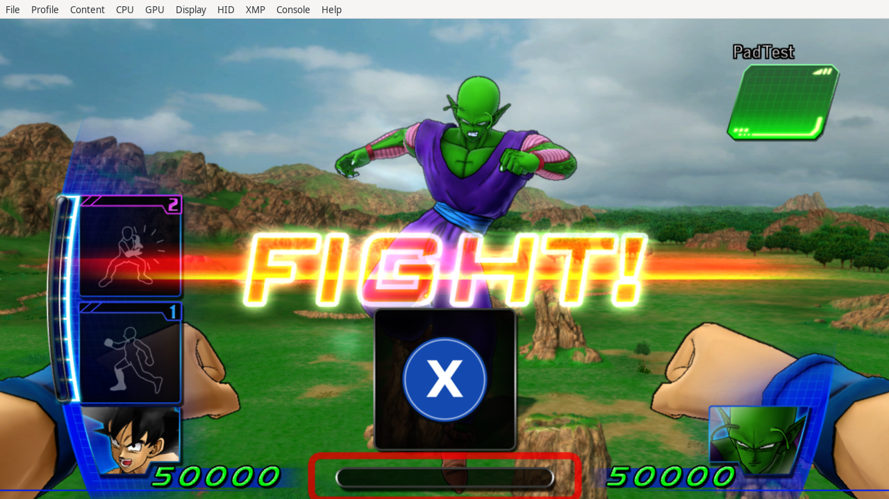

# Version 1.1.2: clean face-button contours and the missing Super clash prompt

The [prominent AI disclaimer](../README.md) applies. Human feedback confirmed
the 1.1.1 guard works. This update preserves that full pose, the guard input,
normal X alternation and all strike/shot/charged trajectories byte-for-byte.
Separate European and USA artifacts are built from the frozen 1.1.1 Europe
patch and the verified regional executable images.

## Human follow-up and public release

On 2026-10-25, RashFaustinho reported that 1.1.2 appeared to work very well and
requested public publication of both regional builds and saves. The latest
message did not identify an edition or explicitly confirm a replay of the exact
N.18/N.17 encounter. [Recorded user feedback](../research/user-feedback-1.1.2.json)
is kept separate from the author-side CPU and emulator observations below.

The public European and USA patch packages each include their optional regional
save and installation/load evidence. Separate save-only ZIPs are also available.
Publication changes packaging and documentation only: gameplay TOMLs and the
validated save bytes retain their tested hashes. [Public release notes](release-1.1.2.md).

## The border was being changed by BC3

Increasing resolution did not address the main remaining problem. The authored
256 px B PNG has a neutral dark contour, but its decoded BC3/DXT5 DDS contains
reddish blocks on that contour. BC3 shares color endpoints across 4×4 texel
blocks; a thin neutral border next to the red disc can lose its color precision.

Under the recorded annulus/color predicate, the old B DDS has **285 reddish
contour texels**, while the new RGBA8 image has zero. Peak red-channel error
against the prior source there drops from 95 to 8 on the 0..255 scale. These
are authored texture measurements, not counts made from the user's screenshot.
[Exact predicate and results](../research/update112-contours.json).

The GPU now receives uncompressed **256×256 RGBA8**, native format 6, with
262,144 bytes per face and the same compact 55% canvas footprint and linear
sampling. Nine other icons retain their exact 128×128 BC3 bytes. Each face is
owned and freed through the same native physical-pool mechanism as 1.1.1;
the four buffers now total 1 MiB, plus native header/alignment overhead.

The final PNG is deliberately authored with sixty opaque RGB colors and
sixty-four neutral-contour alpha levels. Opaque RGB RMS error relative to the
previous supersampled artwork stays below 2/255; maximum alpha change is
3/255. This limited authoring palette is documented rather than described as
an exact lossless conversion of every earlier SVG raster color. The resulting
PNG pixels are copied **exactly** into RGBA8 GPU storage, with no subsequent
BC3 block quantization or red/neutral color mixing. Partially transparent edge
pixels use neutral RGB `(17,24,32)`.

Each startup block stores 128 RGBA palette entries (512 bytes), followed by
raw-LZ4 8-bit indices. Indices decode into the last 64 KiB of the new 256 KiB
allocation. The forward expansion reads each index before its output can
overwrite it, writes one palette RGBA word, and rejects indices above 127.
Only a complete decode/expansion commits ownership, dimensions and fetch words.
Failure frees the uncommitted handle. GPU format is 6, no endian swap, native
metadata format index 0; dimensions/pitch and RGBA swizzle remain explicit.

The packed source totals 27,852 bytes, fitting the same three verified padding
regions as 1.1.1. Only face palette starts require four-byte alignment. The
thirteen-case CPU decoder suite checks exact final bytes, bounds, invalid
metadata, missing/failed allocation, truncated source, invalid palette indices,
cleanup, ABI and repeated-update idempotence including the new GPU buffers.

The public startup patch and all thirteen resources were read back in both
regional emulators. European B/X gameplay screenshots use an earlier candidate
with the **identical RGBA path**, before the final two Super-widget hooks were
added. The exporter verifies this precise difference; the screenshot is not
relabeled as an exact-final-build full-gameplay observation.



## A separate Super-mash selector was still original

The old conversion covered the ordinary attack meter at European `822EE188`.
The Super-mash widget has a second, similar selector at **`822F1608`**, called
by **`822F0F80`**, corresponding to UI-owner slot `+68`. It cycles through four
Kinect punch images. Like the ordinary selector, it only resolves an image if
the old Kinect catalog count at `*(8264910C)+314` equals 4 and the selected
resource is ready. Patching only the first copy left the second copy intact.

The new helper at `825ED700` resolves loaded pad texture index 3 (X), assigns
it to `p_ico_dummy_000`, clears the pose mirror flag and runs the existing
named-group/UV/seal cleanup. It operates independently of that legacy catalog
count. Wrappers execute it after the complete native selector/update, so a
later native animation setup cannot reactivate the Kinect attack/guard groups.
The native OK/NG effects, prohibition seal, progress, input, timings, actors and
results retain their own code and data.

| Native European function | Purpose |
| --- | --- |
| `822F1608`, `822F0F80` | Missing Super-mash selector and complete update |
| `822EE188` | Existing ordinary mash selector, now independent of catalog readiness |
| `822EDCA0`, `822DFF20`, `822E03D8`, `822EE270` | Complete related meter updates/transitions, followed by cleanup |

The added fixture executes both original native mash selectors with absent,
short, unready and ready Kinect catalogs. Complete outer native bodies are
late-animation-reset fixtures, not simulated gameplay. Original named-child
traversal and emitted wrappers execute on PPC. All **168 cases per region**
check X selection, safe pad/part/texture fallbacks, nonvolatile registers, stack,
bounded UI writes, hidden original groups, seal ordering and preserved OK and
progress/result fields. The **1.1.1 negative baseline fails** on the real
`822F1608` selector with an empty catalog, leaving X unassigned.
[Negative baseline](../research/update112-clash-regression.json).

## Native display fixture and its limit

European Vulkan displayed the real Super-mash widget with X and both original
attack/guard pose groups hidden. The final public artifact was combined with
three explicitly LOCAL diagnostics: menu-selector logging, selection of native
Super tutorial group 4 / lesson 118, and one UI show request. The last helper
writes only the panel's `+28` show-request field under that exact tutorial
context; its normal update executes all animation and icon rendering. The
exporter verifies every difference and the actual startup bytes read back.

This is an **isolated UI display test**, not an organically triggered Super
clash. It does not establish clash progress, victory or the complete N.18
versus N.17 encounter. The tutorial group alone did not initialize the full
clash context: a separate Null-GPU attempt found no initialized named panel
parts and timed out. That attempt is not counted as passing. The explicit UI
fixture was used for rendering verification and is excluded from player ZIPs.



## Regional port and release scope

The existing unique-anchor port method remains in use. One new entry hook,
European `822E03D8`, cannot be identified uniquely from its short prologue.
Its USA equivalent `822E0568` is identified by a unique normalized 128-byte
interior anchor, matching normalized 16-byte prologue and equal unwind length
`274`. This fallback maps only the entry or entry+4; it does not infer offsets
through a differently compiled function body. [USA address map](../experiments/gamepad-v1.1.2-usa/address-map.json).

Both exact artifacts pass **nineteen CPU suites**: fifteen existing regressions,
alternating arms, guard geometry, native texture ownership, and clash prompts.
Their immutable public startup bytes and thirteen loaded resources match.
The USA port has mapped native CPU and resource-readback coverage, without a
separate USA graphical capture. There is no new full-campaign, all-character,
Windows/D3D12 or physical-controller claim. The optional USA save is unchanged.

- [European runtime and scope](../experiments/gamepad-v1.1.2-europe/runtime-checks.json)
- [USA runtime and scope](../experiments/gamepad-v1.1.2-usa/runtime-checks.json)
- [European regressions](../experiments/gamepad-v1.1.2-europe/suite-results.json)
- [USA regressions](../experiments/gamepad-v1.1.2-usa/suite-results.json)

## Reproduce

Use the pinned analysis environment in [building](building.md). The contour
asset check needs only the project-owned assets; PPC and emulator checks need
the privately verified original images. No game files are distributed.

```sh
python tools/make_rgba_button_assets.py
python tools/check_contour_assets.py
python tools/build_contour_clash_update.py
python tools/region_port.py --source experiments/gamepad-v1.1.2-europe/4E4D084E.gamepad.patch.toml --output experiments/gamepad-v1.1.2-usa
python tools/check_clash_prompt_cpu.py --patch experiments/gamepad-v1.1.2-europe/4E4D084E.gamepad.patch.toml
python tools/check_clash_prompt_cpu.py --patch experiments/gamepad-v1.1.2-usa/4E4D084E.gamepad.patch.toml
python tools/package_update.py --version 1.1.2 --output dist/1.1.2
```

Run the fifteen scripts listed in `suite-results.json` with the chosen patch,
using `run_ported_cpu_suite.py` for USA, plus the four added fixtures. New
private sessions can be checked with `verify_runtime_patch.py` and
`verify_hd_runtime.py --assets assets/controller-rgba`. The scoped exporter
`report_contour_clash_update.py` requires its retained session evidence and
does not generate or fabricate observations during ordinary builds.
